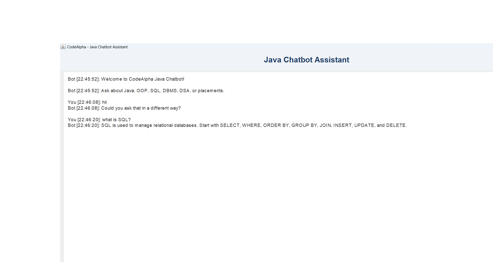

# Java Chatbot Assistant

A Java-based chatbot application featuring a graphical user interface, rule-based responses, and persistent conversation history. Built as a hands-on Java development project to practice object-oriented programming, GUI development, and file handling.

## Application Screenshot



## Features

- **Interactive GUI:** User-friendly interface built with Java Swing.
- **Rule-Based Responses:** Responds to greetings, Java, SQL, DBMS, DSA, aptitude, and placement-related questions.
- **Quick Suggestions:** Predefined buttons for common queries.
- **Chat Timestamps:** Displays timestamps for conversations.
- **Persistent Chat History:** Saves conversations locally to a text file.
- **View History:** Review previously saved conversations.
- **Search History:** Find saved messages using keywords.
- **Export History:** Export saved conversations to a selected location.
- **Clear Chat:** Clear messages from the current chat window.
- **New Chat:** Start a fresh conversation window.
- **Keyboard Support:** Send messages by pressing Enter.
- **Exit Confirmation:** Confirmation prompt before closing the application.

## Tech Stack

- Java (JDK 17 or later)
- Java Swing
- Object-Oriented Programming (OOP)
- File Handling
- Java Date and Time API

## Project Structure

```text
CodeAlpha_Chatbot/
├── Main.java
├── ChatbotGUI.java
├── ChatbotEngine.java
├── ChatHistory.java
├── README.md
├── .gitignore
└── screenshots/
    └── chatbot-gui-fixed.png
```

### File Descriptions

- `Main.java` — Console application entry point.
- `ChatbotGUI.java` — Graphical user interface and user interactions.
- `ChatbotEngine.java` — Rule-based response processing.
- `ChatHistory.java` — Saves, searches, and exports conversation history.
- `.gitignore` — Excludes compiled files and local chat history from Git.

The `chat_history.txt` file is generated locally when the application saves conversations. It is not required in the repository.

## Prerequisites

- Java JDK 17 or later
- Visual Studio Code or another Java-compatible IDE
- A terminal or command prompt

Verify your Java installation:

```bash
java -version
javac -version
```

## Getting Started

### 1. Clone the Repository

```bash
git clone https://github.com/tamilarasisanjai23-ops/CodeAlpha_Chatbot.git
cd CodeAlpha_Chatbot
```

### 2. Compile the Application

```bash
javac Main.java ChatbotEngine.java ChatHistory.java ChatbotGUI.java
```

### 3. Run the GUI Version

```bash
java ChatbotGUI
```

### 4. Run the Console Version

```bash
java Main
```

## How to Use

1. Launch the GUI application.
2. Type a message in the input field.
3. Click **Send** or press Enter.
4. Use the suggestion buttons for quick questions.
5. Open **View History** to review saved conversations.
6. Use **Search History** to find messages by keyword.
7. Use **Export History** to save a copy of the conversation history.
8. Use **Clear Chat** or **New Chat** to clear the current visible conversation.

## Project Type

Educational Java project developed for internship learning and practical programming experience. The chatbot currently uses rule-based responses rather than a trained AI model.

## Future Enhancements

- Expand the chatbot's knowledge base.
- Integrate an NLP or AI model.
- Improve conversational context handling.
- Add automated tests and enhanced error handling.

## Author

Developed as part of Java programming and internship learning.

## License

No license has been specified yet.
